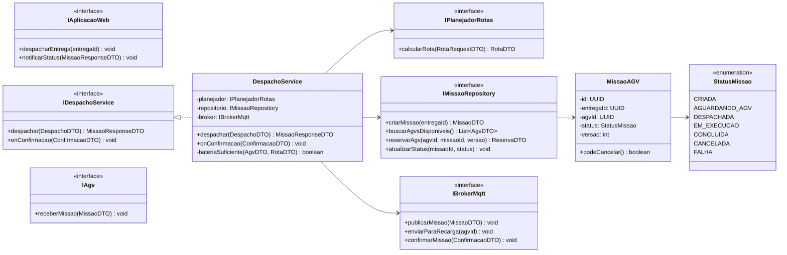

# Diagrama de Classes e Interfaces - Despacho de Missão

As interfaces abaixo têm os métodos chamados no [diagrama de sequência](sequencia.md).

| Participante na sequência | Interface |
|---|---|
| Aplicação Web | `IAplicacaoWeb` |
| API de Orquestração | `IDespachoService` |
| Planejador de Rotas | `IPlanejadorRotas` |
| Banco de Dados | `IMissaoRepository` |
| Broker MQTT | `IBrokerMqtt` |
| AGV | `IAgv` |
