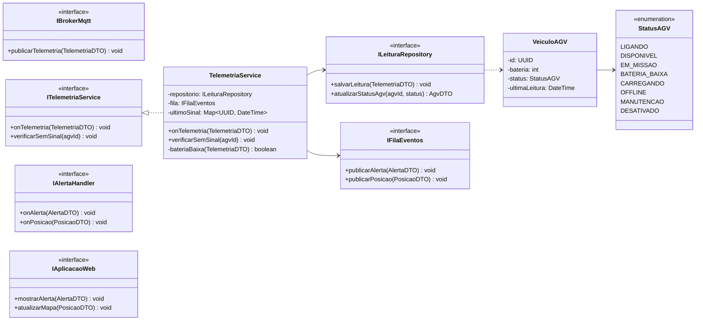

# Diagrama de Classes e Interfaces - Telemetria

Métodos usados no [diagrama de sequência](sequencia.md).

| Participante na sequência | Interface |
|---|---|
| Broker MQTT | `IBrokerMqtt` |
| Serviço de Telemetria | `ITelemetriaService` |
| Banco de Dados | `ILeituraRepository` |
| RabbitMQ | `IFilaEventos` |
| API de Orquestração | `IAlertaHandler` |
| Aplicação Web | `IAplicacaoWeb` |
