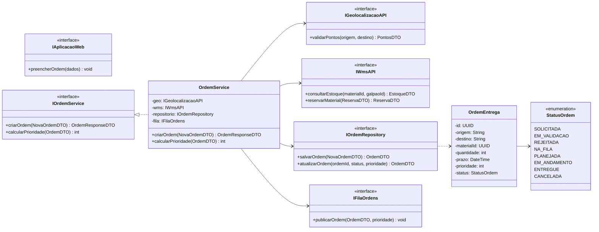

# Diagrama de Classes e Interfaces - Ordens de Entrega

Métodos usados no [diagrama de sequência](sequencia.md).

| Participante na sequência | Interface |
|---|---|
| Aplicação Web | `IAplicacaoWeb` |
| API de Orquestração | `IOrdemService` |
| API de Geolocalização | `IGeolocalizacaoAPI` |
| API de Armazéns (WMS) | `IWmsAPI` |
| Banco de Dados | `IOrdemRepository` |
| RabbitMQ | `IFilaOrdens` |
