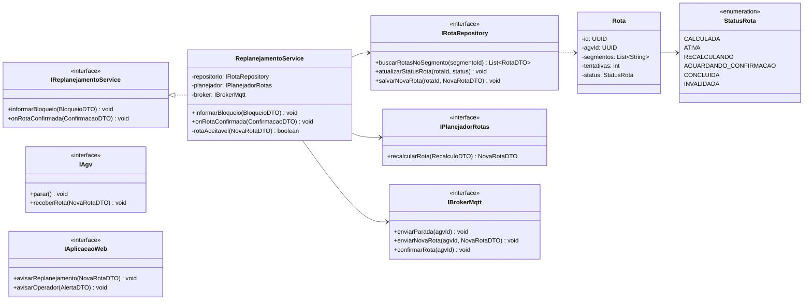

# Diagrama de Classes e Interfaces - Replanejamento de Rota

Métodos usados no [diagrama de sequência](sequencia.md).

| Participante na sequência | Interface |
|---|---|
| API de Orquestração | `IReplanejamentoService` |
| Banco de Dados | `IRotaRepository` |
| Planejador de Rotas | `IPlanejadorRotas` |
| Broker MQTT | `IBrokerMqtt` |
| AGV | `IAgv` |
| Aplicação Web | `IAplicacaoWeb` |
